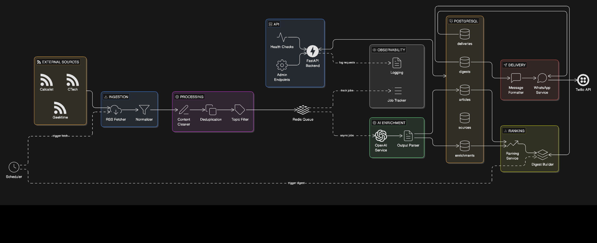

# Israeli Tech News Intelligence System

An AI-powered backend pipeline that ingests Israeli technology news from RSS feeds, enriches every article with an LLM (summary, category, tags, importance score, Israel relevance), ranks the most important stories and delivers a Hebrew digest to WhatsApp — with one command.

---

## How it works

```text
RSS feeds ──► Fetch (httpx) ──► Parse (feedparser) ──► Normalize + canonicalize URL + SHA-256
                                                                │
                                                     PostgreSQL: articles (deduplicated)
                                                                │
                                OpenAI Responses API (strict JSON schema) ──► Pydantic validation
                                                                │
                                                 PostgreSQL: article_enrichments
                                                                │
                       Rank by importance (last 24h, Israel-relevant) ──► Digest ──► WhatsApp (Twilio)
```



`scripts/run_pipeline.py` runs every step through `PipelineService`. Each step is also available as its own script.

---

## Tech stack

| Area | Tools |
|---|---|
| Language | Python 3.9+ |
| Database | PostgreSQL 16, SQLAlchemy 2.0, Alembic |
| AI | OpenAI Responses API with structured outputs, Pydantic validation |
| Ingestion | httpx, feedparser |
| Delivery | Twilio WhatsApp API |
| API | FastAPI (health check) |
| Infra / tests | Docker Compose, pytest |

---

## Quickstart

```bash
# 1. Install
python3 -m venv .venv && source .venv/bin/activate
pip install -r requirements.txt

# 2. Configure (fill in OpenAI + Twilio keys)
cp .env.example .env

# 3. Start PostgreSQL and create the schema
docker compose up -d
alembic upgrade head

# 4. Add the RSS sources
python -m scripts.seed_sources

# 5. Run the whole pipeline
python -m scripts.run_pipeline --no-send   # build the digest only (saved to output/latest_digest.txt)
python -m scripts.run_pipeline             # ... and send it to WhatsApp
```

### Individual steps

| Command | What it does |
|---|---|
| `python -m scripts.run_ingestion_once` | Fetch all active RSS sources and store new articles |
| `python -m scripts.enrich_pending --limit 20` | Enrich articles that have no enrichment yet |
| `python -m scripts.generate_digest` | Build the digest and save it to `output/latest_digest.txt` |
| `python -m scripts.send_digest_to_whatsapp` | Build the digest and send it to WhatsApp |
| `uvicorn app.main:app` | Start the API (`GET /api/v1/health`) |

---

## Configuration

All configuration is read from environment variables / `.env` by `app/core/config.py`. See `.env.example`.

| Variable | Description | Default |
|---|---|---|
| `POSTGRES_HOST`, `POSTGRES_PORT`, `POSTGRES_DB`, `POSTGRES_USER`, `POSTGRES_PASSWORD` | Database connection | matches `docker-compose.yml` |
| `OPENAI_API_KEY`, `OPENAI_MODEL` | OpenAI credentials and model | model: `gpt-4.1-mini` |
| `OPENAI_TIMEOUT_SECONDS` | Timeout per OpenAI request | `30` |
| `TWILIO_ACCOUNT_SID`, `TWILIO_AUTH_TOKEN` | Twilio credentials | — |
| `TWILIO_WHATSAPP_FROM`, `WHATSAPP_TO` | Sender / recipient (`whatsapp:+...`) | — |
| `RSS_TIMEOUT_SECONDS` | HTTP timeout per feed | `15` |
| `ENRICHMENT_BATCH_SIZE` | Max articles enriched per run | `20` |
| `DIGEST_SIZE` | Articles per digest | `5` |
| `DIGEST_WINDOW_HOURS` | Only include articles from this window | `24` |
| `DIGEST_ISRAELI_ONLY` | Only include Israel-relevant articles | `true` |

---

## Project structure

```text
app/
 ├── core/            # settings, database session, logging
 ├── models/          # SQLAlchemy models: Source, Article, ArticleEnrichment
 ├── repositories/    # database access only (no business logic)
 ├── schemas/         # Pydantic model that validates LLM output
 ├── services/
 │    ├── ingestion/  # RSS fetch, parse, normalize, SourceFetchService
 │    ├── processing/ # URL canonicalizer, SHA-256 hasher
 │    ├── ai/         # generic OpenAI client, prompts + JSON schema, EnrichmentService
 │    ├── ranking/    # DigestBuilder (WhatsApp formatting)
 │    ├── delivery/   # WhatsAppSender (Twilio)
 │    └── pipeline_service.py   # orchestrates the full flow
 └── api/             # FastAPI health endpoint
scripts/              # CLI entry points (python -m scripts.<name>)
migrations/           # Alembic migrations
tests/
 ├── unit/            # pure logic and external-client wrappers (fakes)
 └── integration/     # repositories and services against in-memory SQLite
```

---

## Database design

| Table | Purpose |
|---|---|
| `sources` | RSS source configuration (feed URL, language, priority, active flag, last fetch time) |
| `articles` | Normalized articles; `canonical_url` is unique, so it's the deduplication key. `status`: `ingested` → `enriched` / `enrichment_failed` |
| `article_enrichments` | AI output: category, summary, why it matters, tags, importance score, Israel relevance and the raw LLM response. One per article (unique `article_id`) |

---

## Example output

AI enrichment, validated against a strict JSON schema:

```json
{
  "category": "סטארטאפים וטכנולוגיה",
  "short_summary": "אמזון מנהלת מגעים לרכישת דקארט הישראלית ב-7 מיליארד דולר.",
  "why_it_matters": "הרכישה תשפיע על שוק ה-AI ותדגיש את חשיבות הסטארטאפים הישראליים בתחום.",
  "tags": ["אמזון", "דקארט", "AI"],
  "importance_score": 9,
  "is_israeli_relevant": true
}
```

A WhatsApp message (one message per article):

```text
עדכון חדשות טכנולוגיה (1/4)

1. עכשיו זו אמזון שרוצה לרכוש את דקארט ב-7 מיליארד דולר
אמזון מנהלת מגעים לרכישת דקארט הישראלית ב-7 מיליארד דולר.
למה זה חשוב: הרכישה תשפיע על שוק ה-AI ותדגיש את חשיבות הסטארטאפים הישראליים בתחום.
תגיות: אמזון, דקארט, AI
דירוג חשיבות: 9.0/10
https://www.geektime.co.il/amazon-to-acquire-decart-israeli-ai-startup-for-7-billion-report/
```

---

## Testing

```bash
pytest
```

The 44 tests run in under a second and need no database or network:

- **Unit:** URL canonicalization, hashing, RSS parsing, normalization (including date formats and missing fields), digest formatting, LLM output validation, and the OpenAI/Twilio wrappers with fake SDK clients.
- **Integration:** repositories, ingestion (dedup, bad entries, failing feeds), enrichment (success, API failure, invalid LLM output, idempotency) and the full pipeline, all against in-memory SQLite.

Services receive their external clients through their constructors, so tests swap in fakes without patching.

---

## Design decisions & trade-offs

- **Repository / service split.** Repositories only run queries; services hold the business logic; scripts are thin CLI wrappers. Each layer is easy to test and replace.
- **Deduplication by canonical URL.** Tracking parameters (`utm_*`, `fbclid`, …) and fragments are stripped, so the same story shared with different links is stored once. The unique constraint backs this up at the database level.
- **Never trust raw LLM output.** The Responses API is called with a strict JSON schema, and the result is validated again with Pydantic (score range, required fields, at most 3 tags). An invalid response marks the article `enrichment_failed` instead of crashing the batch.
- **Failure isolation.** One broken feed doesn't stop the other sources. One bad entry doesn't roll back its feed (each insert runs in a savepoint). One failed LLM call or WhatsApp message doesn't stop the rest.
- **Idempotent runs.** Re-running ingestion skips known URLs. Enrichment only picks up articles without an enrichment, and the database enforces one enrichment per article.
- **Digest freshness via a time window.** Only the last `DIGEST_WINDOW_HOURS` are ranked. This is deliberately simple: running the pipeline twice in the same window sends the same digest again. Recording a `sent_at` per article would fix that if the pipeline were scheduled.
- **Deliberately out of scope:** a scheduler, queues (Redis/Celery), RAG and a dashboard. The pipeline is a single batch job; cron or a scheduler could run `run_pipeline` as-is.

---

## Future improvements

- Schedule `run_pipeline` (cron, GitHub Actions or a worker) and track sent articles
- Retry with backoff for OpenAI and Twilio calls
- More sources and better ranking (source weight, recency decay, cross-source similarity via `title_hash`)
- Containerize the pipeline itself and add CI
